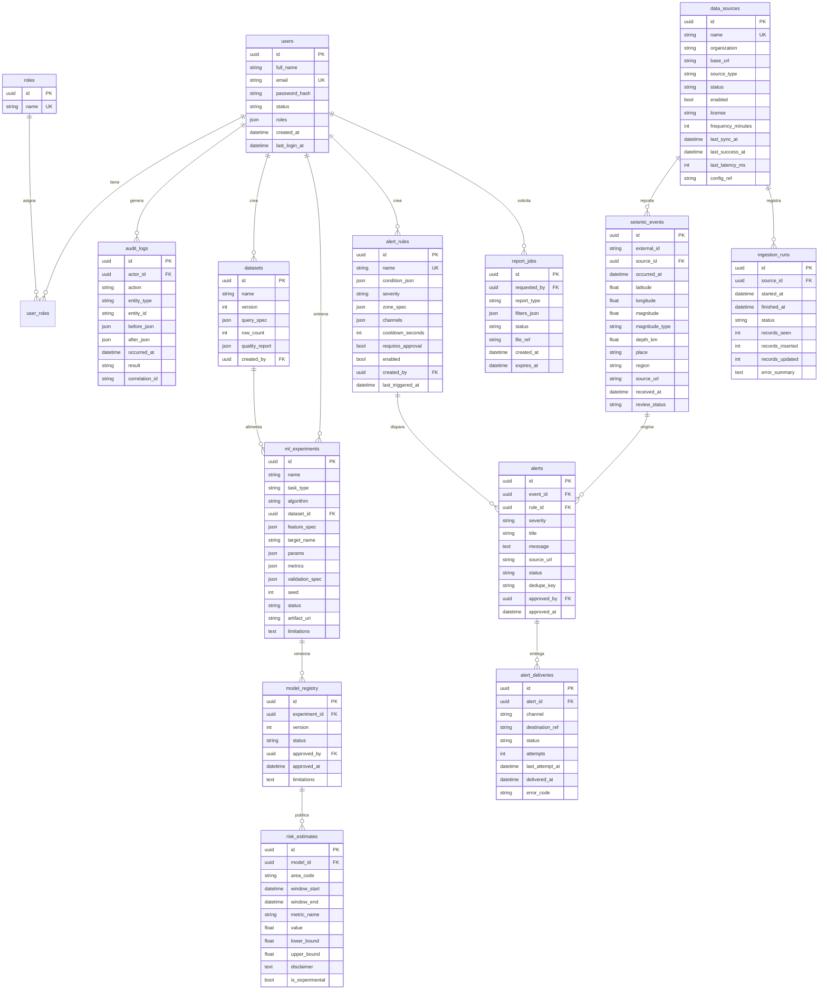

# Modelo de datos — diagrama ER

Migracion inicial: `database/migrations/versions/0001_inicial.py` (UUID internos, UTC, CHECK de rangos).

Reglas clave:
- `seismic_events`: unica `(external_id, source_id)` → ingesta idempotente sin duplicados.
- `alerts`: unica `(event_id, rule_id, dedupe_key)` → deduplicacion de avisos.
- `risk_estimates`: jamas se mezclan con eventos observados; toda fila identifica modelo/versions y lleva disclaimer.
- `audit_logs`: bitacora protegida; sin tokens ni secretos.
